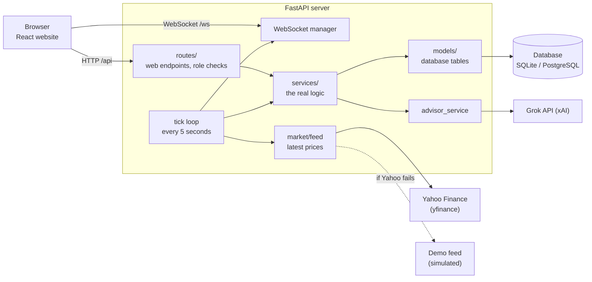
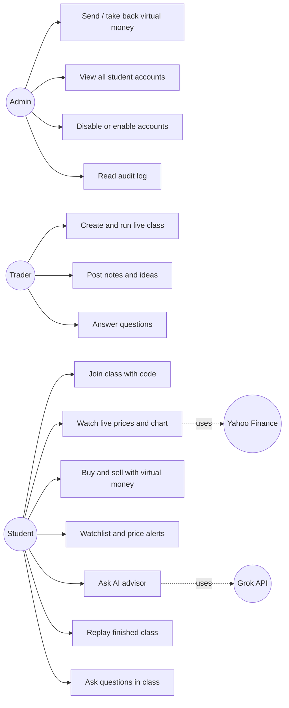
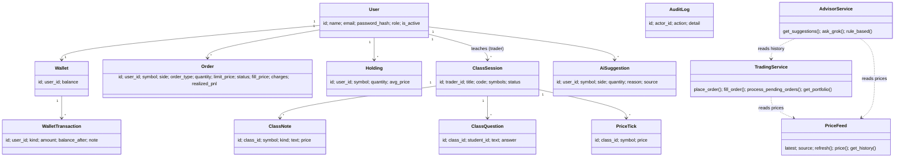
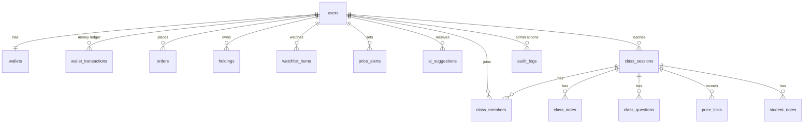
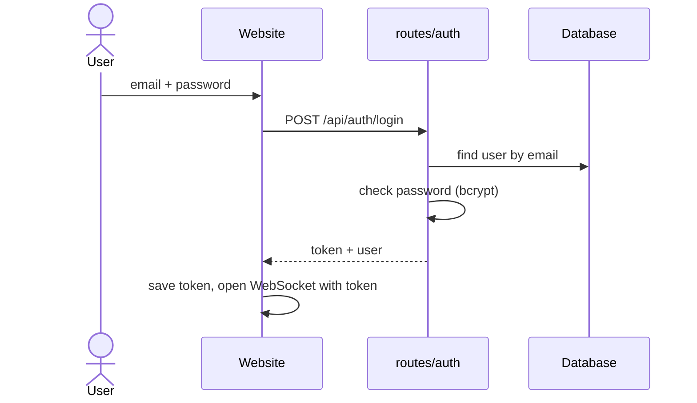
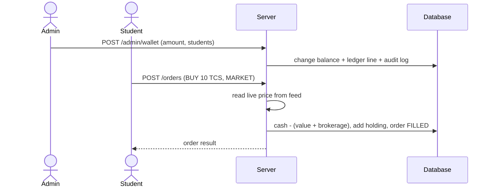
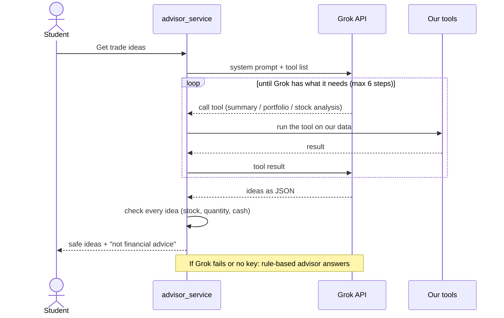
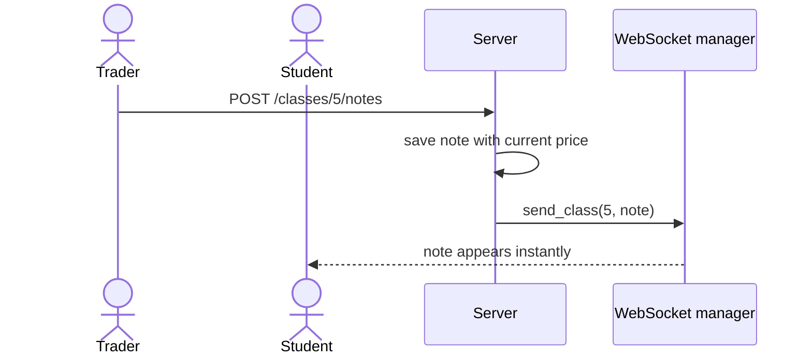
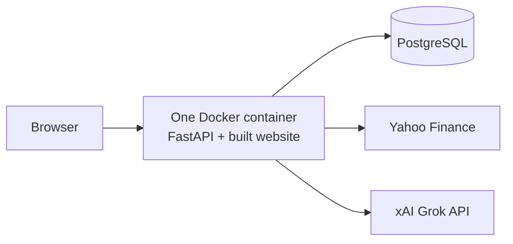

# Design: architecture and UML

The diagrams use Mermaid. GitHub shows them automatically; in VS Code install the "Markdown Preview Mermaid Support" extension.

## 1. Architecture

Three layers on the server, so every file has one job:

- **routes** read the request, check who is calling, call a service, and return the answer.
- **services** hold the rules (trading, wallet, classes, advisor). They do not know about HTTP.
- **models** are the database tables.
- **market** holds the live prices in memory and talks to Yahoo.

## 2. Use cases

## 3. Class diagram (main classes)

## 4. Database (ER diagram)

## 5. Sequence: login

## 6. Sequence: admin sends money, student buys

## 7. Sequence: AI advisor (agent)

## 8. Sequence: live class note

## 9. Deployment

## 10. Design decisions (and why)

| Decision | Reason |
|---|---|
| One container serves both website and API | Easiest to run, deploy and explain |
| Orders fill at the live price (no order book) | Keeps the project simple; students learn trading, not exchange internals |
| Prices kept in memory, pushed by WebSocket | Fast and simple; only class prices are saved for replay |
| AI ideas are checked by our code | The AI can make mistakes; the system never trusts it blindly |
| Rule-based advisor as a backup | The feature works with no key and no internet |
| Plain functions and small files | The code is easy to read and explain |
